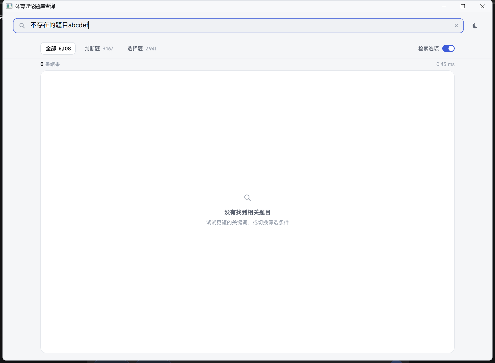

# 🏃 体育理论题库查询系统 · v3

Windows 单文件绿色便携应用：内置 6,108 道体育理论题库（判断 3,167 / 单选 2,494 / 多选 433），
输入关键词即输即显，答案直达，无需安装、无外部依赖、无网络。

前端已按 `design/` 中的高保真稿重构为 **Direct2D + DirectWrite** 渲染，
采用**唯一的一种导航模型：连续滚动**（彻底移除翻页与"每页条数"）。

---

## 📸 界面预览

| 浅色 · 实时检索 | 深色 · 滚动浏览 |
| :---: | :---: |
|  |  |

| 一键复制反馈 | 空状态 |
| :---: | :---: |
|  |  |

---

## ✨ 本次重构做了什么

### 1. 一套导航逻辑：只有滚动
旧版同时存在"20/50/100 条每页 · 首页/上一页/下一页/尾页"与"鼠标滚轮滚动"，
两种模型互相打架。新版删除全部分页 UI 与页码状态，只保留连续滚动：

- 虚拟化列表：只排版屏幕内的条目，6,108 条也能秒开；
- 后台预测量 + 高度缓存（按题目 id + 内容宽度缓存），二次检索零测量开销；
- 自定义滚动条：可拖动、可点击轨道跳转；拖动期间冻结映射，绝不跳动；
- 滚轮/键盘平滑滚动（指数缓动），`PgUp/PgDn` 翻屏，`Ctrl+Home/End` 首尾；
- 浮动"回到顶部"按钮在滚动超过 320 DIP 后出现。

### 2. 字体：从 GDI+ 换成 DirectWrite 矢量排版
- 字体栈：`MiSans VF` → `Noto Sans SC` → `Microsoft YaHei UI`（自动降级）；
- 字重走变量字体真实实例（400→450、500→520、600→630），不再出现"合成加粗"的糊字；
- 灰度抗锯齿 + 统一 1.7 倍行高，中文长句阅读更稳；
- 原生搜索框通过 GDI 字体探测保证与 DirectWrite 文本同一字面（不再"框里一个样、正文一个样"）。

### 3. 视觉：设计令牌驱动的安静界面
- 颜色/字号/间距/圆角全部来自 `design/mock.css` 的令牌（见 `design/tokens.md`）；
- 单一内容面板（圆角 14 + 1px 描边），条目间只用 1px 发丝线分隔，hover 整行淡染；
- 答案不再是通栏彩色条，而是元信息行右侧的克制胶囊：`✓正确 / ✕错误 / 答案 C`；
- 关键词命中显示为蓝色 chip；正确选项在选项列表中直接以绿色加粗标出；
- 选项采用**悬挂缩进**，长选项换行后与正文对齐；
- 复制按钮只在行 hover 时浮现（占位不跳版），点击后就地变为 `✓` 并提示"已复制"；
- 深浅双主题与 Windows 11 标题栏、窗口描边同步；完整 Per-Monitor V2 DPI 适配。

### 4. 工程
- 渲染：Direct2D 1.0 HwndRenderTarget（垂直同步、无闪烁、GPU 合成），
  圆角图层裁剪保证 hover 与面板圆角不打架；
- 数据/检索沿用高命中率的 `Database` 与 `SearchEngine`（多关键词与选项检索、毫秒级）；
- 静态链接，单文件 4.4 MB；冷启动约 0.25 s（含内嵌题库解包与 6,108 题解析），
  内存约 60 MB（Direct2D 硬件合成缓冲区占大头，换取矢量文字与 60/120 fps 滚动）。

---

## ⌨️ 交互速查

| 操作 | 效果 |
| --- | --- |
| 输入 | 实时检索（多关键词空格分隔） |
| 滚轮 / 拖动滚动条 / 点击轨道 | 连续滚动 |
| `Ctrl+F` | 聚焦搜索框并全选 |
| `Esc` | 清空搜索 |
| `Ctrl+T` | 浅色 / 深色切换 |
| `PgUp / PgDn` | 上 / 下翻一屏 |
| `Ctrl+Home / Ctrl+End` | 回到顶部 / 跳到末尾 |
| 悬停条目 + 点击右上角图标 | 复制"题型 + 题干 + 选项 + 答案" |
| 点击筛选胶囊 / "检索选项"开关 | 按类型过滤 / 是否检索选项内容 |

---

## 🚀 使用

直接运行 `dist/体育理论题库查询.exe`（或 `dist/SportExamSearch.exe`，同一文件）。
外置 `question.db` 存在时优先生效，否则使用 EXE 内嵌题库。

## 🛠️ 构建

双击 `打包程序.bat`（需要 MinGW-W64 g++ 15+ 与 windres），产物为 `dist/体育理论题库查询.exe`。

核心源文件：

```
src/
├── common.h          基础类型、几何、颜色、DPI 与剪贴板工具
├── theme.h           浅/深色设计令牌（与 design/mock.css 对应）
├── fonts.h/.cpp      DirectWrite 字体栈、字重映射、文本测量与 GDI 字体探测
├── gfx.h/.cpp        Direct2D 设备、画刷缓存、圆角/椭圆/图标/圆角裁剪
├── result_list.h/.cpp 虚拟化结果列表：测量、滚动、拖动、hover、复制反馈
├── main.cpp          窗口、布局、绘制、输入、原生搜索框（IME）集成
├── database.h/.cpp   SQLite 题库加载（内嵌资源优先）
├── search.h/.cpp     多关键词检索与类型过滤
└── resource.h/.rc    资源脚本（内嵌题库 + 高 DPI 清单）
```

设计资产：`design/mock.css`、`design/light.html`、`design/dark.html`、`design/states.html`，
渲染图见 `design/renders/`，规格见 `design/tokens.md` 与 `design/layout.md`。

开发期视觉回归脚本：`tools/ui.ps1`（按操作脚本注入消息并截图）、`tools/shot.ps1`（单张截图）。

---

## 📊 与旧版对比

| 指标 | 旧版（GDI+ 卡片 + 分页） | 当前版（Direct2D/DirectWrite） |
| --- | --- | --- |
| 导航模型 | 分页 + 滚动混用 | 只有连续滚动 |
| 字体渲染 | GDI+ 位图描边，中文糊 | DirectWrite 矢量，可读性显著提升 |
| 分页控件 | 首页/上一页/下一页/尾页 + 每页条数 | 全部移除 |
| 单手浏览 6,108 题 | 需不断点"下一页" | 滚轮/拖动即可，虚拟化不卡顿 |
| 体积 | 4.38 MB | 4.39 MB |
| 冷启动 / 内存 | ~0.1 s / ~16 MB | ~0.25 s / ~60 MB（D2D 硬件合成） |